<p align="center">
  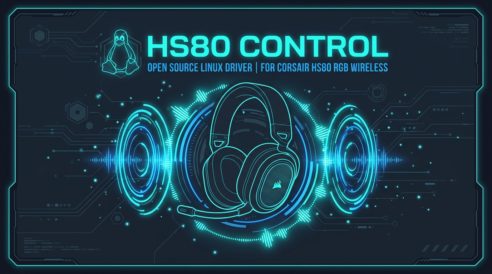
</p>

<p align="center">
  <b>🇬🇧 English</b> &nbsp;|&nbsp; <a href="README.de.md">🇩🇪 Deutsch</a>
</p>

# HS80 Control — Native Linux driver and control app for the Corsair HS80 RGB Wireless

[](https://github.com/ST1CKEL/HS80_Control/actions/workflows/check.yml)
[](https://github.com/ST1CKEL/HS80_Control/releases/latest)
[](LICENSE)
[](https://www.python.org/)
[](https://gnome.pages.gitlab.gnome.org/libadwaita/)
[](https://pipewire.org/)
[](https://fedoraproject.org/)
[](https://stickelbroeck.com/)

**HS80 Control** gives you full control of the **Corsair HS80 RGB Wireless** gaming headset on Linux — no Windows, no iCUE. It works wirelessly through the bundled USB receiver (`1b1c:0a6b`) and with the headset plugged in directly by USB cable (`1b1c:0a69`).

It consists of a lightweight background service (`hs80d`), a D-Bus interface, a scriptable command-line tool (`hs80ctl`) and an adaptive GTK4/libadwaita app (`hs80-control`) that fits into GNOME, KDE Plasma and other desktops on Wayland and X11. The interface is available in English and German.

---

## Contents

- [Features](#features)
- [Screenshots](#screenshots)
- [Installation](#installation)
- [Hardware compatibility](#hardware-compatibility)
- [System requirements](#system-requirements)
- [Resource usage](#resource-usage)
- [Command line (hs80ctl)](#command-line-hs80ctl)
- [Graphical app (hs80-control)](#graphical-app-hs80-control)
- [Spatial audio (binaural 7.1)](#spatial-audio-binaural-71)
- [Microphone and DSP](#microphone-and-dsp)
- [D-Bus interface](#d-bus-interface)
- [Architecture](#architecture)
- [Protocol and reverse engineering](#protocol-and-reverse-engineering)
- [Troubleshooting](#troubleshooting)
- [Development, tests and packaging](#development-tests-and-packaging)
- [Contributing](#contributing)
- [License and disclaimer](#license-and-disclaimer)

---

## Features

- 🔋 **Live battery level and charging state** from hardware events, re-read once a minute so a lost event cannot leave it wrong.
- 🪫 **Low-battery warning**: a desktop notification at 20 % and an urgent one at 10 %, even with the window closed. On by default; switch it off on the overview page or with `hs80ctl battery-warning off`.
- 🗣️ **Voice announcements on the headset**: “Microphone muted”, “Microphone activated”, “Charging battery”, “Battery low” and more, in English or German, played on the headset itself. Each group and the volume can be set.
- 💡 **RGB lighting**: five modes (*off*, *static*, *pulse*, *rainbow*, *cycle*) with adjustable tempo, brightness and three separately coloured zones (*logo*, *status*, *microphone LED*). Changes preview instantly; combinations can be saved as profiles.
- 🔇 **Mute indicator**: the microphone LED switches to a colour of your choice while muted.
- 🌙 **Battery-friendly lighting**: effects run at 10 instead of 25 frames per second, unchanged frames are not resent, and the lighting can dim or switch off when the battery runs low.
- ⏱️ **Sleep timer**: automatic power-off after 0 to 90 minutes of inactivity.
- 🎙️ **Hardware sidetone**: zero-latency monitoring of your own voice from `-42 dB` to `+4 dB`.
- 🎚️ **Microphone gain and mute**: hardware gain from `-36 dB` to `0 dB` and ALSA capture mute.
- 🎧 **Binaural 7.1 spatial audio** through PipeWire, using SOFA HRTF filter chains (`pipewire-module-filter-chain-sofa`).
- 🔌 **USB cable mode**: the headset switched on and plugged in works without the receiver, with full audio and control.
- ⚡ **Clear device states**: a switched-off headset on its charging cable (`1b1c:0a6a`) is recognised and explained instead of showing a blank status.
- 🔄 **Fast reconnect** at the press of a button, without restarting the service.
- 🖥️ **Tray icon and autostart**: starts minimised at login and shows the battery level in the system tray.
- ⬆️ **In-app updates** from the GitHub releases, checked against the published SHA-256 checksum.
- 📦 **Graphical installer for Fedora** (KDE Plasma and GNOME) as a single `.run` file.
- 🤖 **D-Bus API and JSON output** for scripts, Waybar, Polybar or Home Assistant.

---

## Screenshots

The app follows the system's light/dark scheme and accent colour (shown here on KDE Plasma, dark theme). The screenshots show the German interface; the app switches to English on first start or under “Language”.

| Overview and device status | RGB lighting and zones |
| :---: | :---: |
| 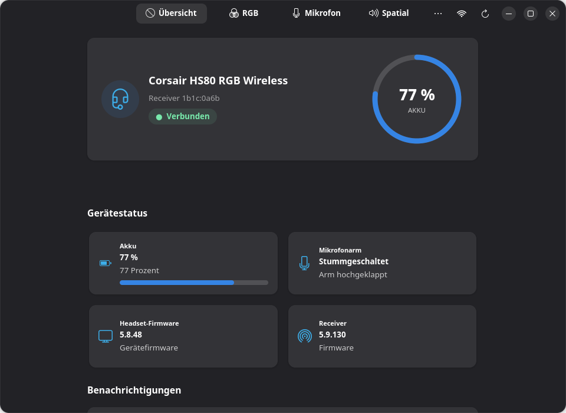 | 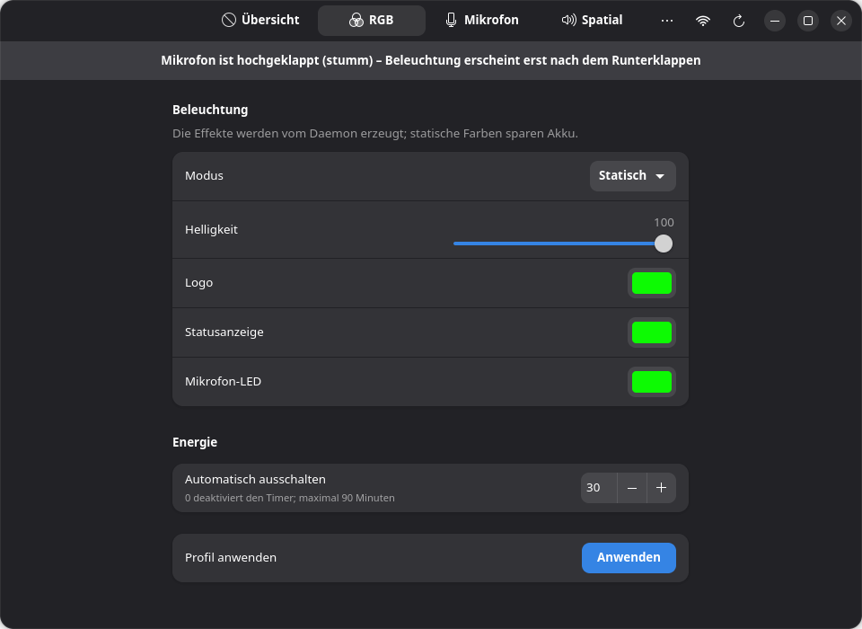 |
| *Connection badge, battery ring, firmware and status cards* | *Profiles, mode, brightness, tempo and zone colours with instant preview* |

| Microphone, sidetone and gain | Binaural 7.1 spatial audio |
| :---: | :---: |
| 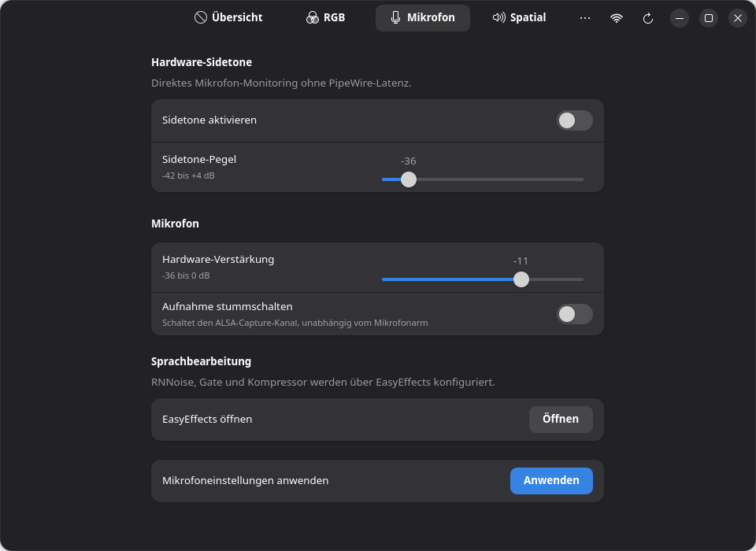 | 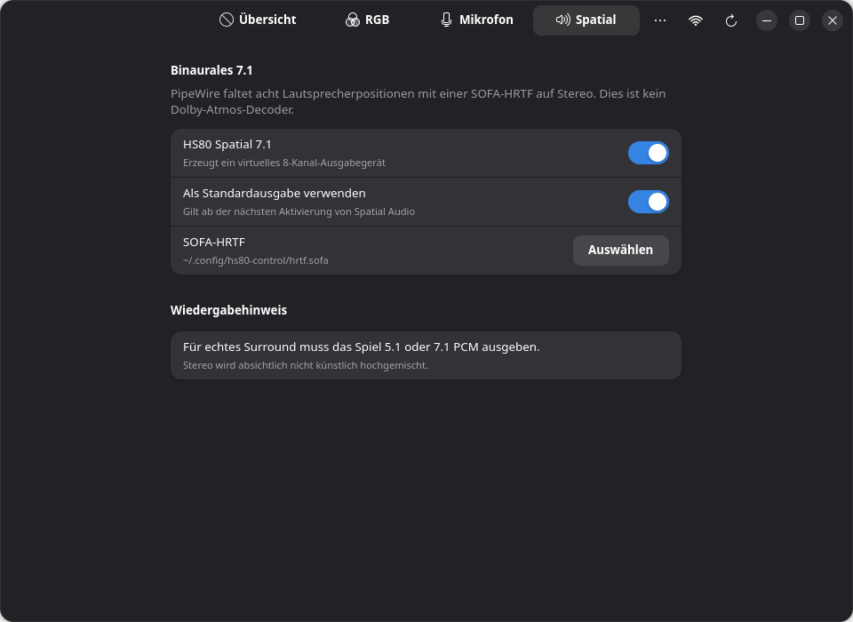 |
| *Zero-latency sidetone, hardware gain and a shortcut to EasyEffects* | *SOFA HRTF convolution and default-output choice* |

| Battery warning, tray and autostart | Mute indicator and power saving |
| :---: | :---: |
| 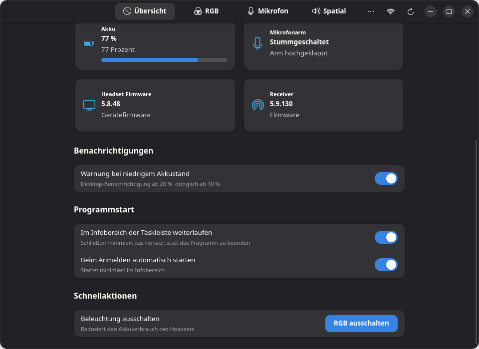 | 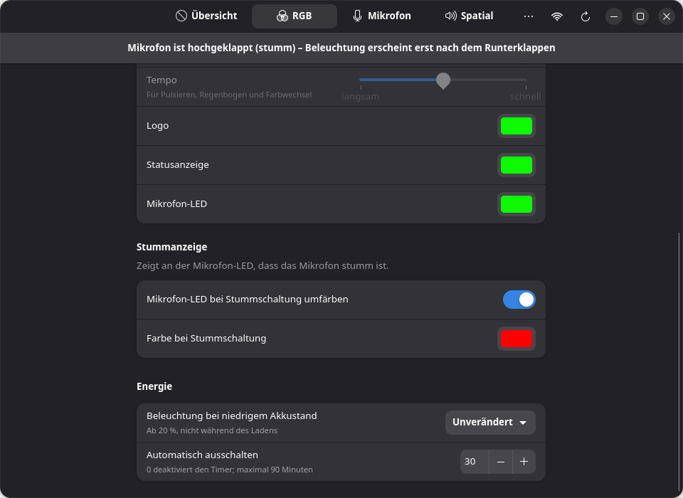 |
| *Switches for the battery warning, staying in the tray and starting at login* | *Mute colour, lighting at low battery and sleep timer* |

---

## Installation

### Fedora: COPR repository (recommended)

```bash
sudo dnf copr enable stickel/hs80-control
sudo dnf install hs80-control
systemctl --user enable --now hs80d.service
```

Unplug the receiver and plug it back in once so the udev rule grants your user access. Updates then arrive with `sudo dnf upgrade` like any other package. The repository is at [copr.fedorainfracloud.org/coprs/stickel/hs80-control](https://copr.fedorainfracloud.org/coprs/stickel/hs80-control/).

### Fedora: graphical installer (KDE Plasma and GNOME)

The easiest way is the installer from the [latest release](https://github.com/ST1CKEL/HS80_Control/releases/latest). It contains the RPM package and asks for the language, autostart and — on GNOME — the tray extension:

```bash
sh hs80-control-installer-*.run
```

It asks once for the administrator password through the desktop's dialog. Missing GTK 4, libadwaita or PyGObject (possible on a minimal KDE install) are installed with `dnf` first.

Later versions are installed by the app itself: **Overview → Updates → “Check for updates”**. The update check talks to the GitHub API only and sends no device data.

### Fedora: RPM package only

```bash
sudo dnf install ./hs80-control-*.noarch.rpm
systemctl --user restart hs80d.service
```

### Arch Linux

A `PKGBUILD` is in [`packaging/aur/`](packaging/aur/):

```bash
git clone https://github.com/ST1CKEL/HS80_Control.git
cd HS80_Control/packaging/aur
makepkg -si
systemctl --user enable --now hs80d.service
```

### Any distribution: user install (no root for the app)

```bash
git clone https://github.com/ST1CKEL/HS80_Control.git
cd HS80_Control

# Install into ~/.local/
make install-user

# Once: the udev rule that grants your user access to the headset
sudo install -Dm0644 data/udev/70-hs80-control.rules /usr/lib/udev/rules.d/70-hs80-control.rules
sudo udevadm control --reload-rules && sudo udevadm trigger

# Unplug the receiver and plug it back in
```

Then check the state:

```bash
hs80ctl status
hs80-control
```

Make sure `~/.local/bin` is in your `$PATH`. To remove it again: `make uninstall-user`.

### System-wide install

For packagers or a system-wide setup:

```bash
sudo make install
sudo udevadm control --reload-rules && sudo udevadm trigger
systemctl --user daemon-reload
systemctl --user enable --now hs80d.service
```

### Running from the source tree

```bash
./bin/hs80d --debug        # terminal 1: the service
./bin/hs80ctl status       # terminal 2: the CLI
./bin/hs80-control         # or the app
```

---

## Hardware compatibility

| Connection | USB vendor and product ID | Status | Notes |
| :--- | :--- | :---: | :--- |
| **Wireless receiver** | Receiver `1b1c:0a6b`, headset PID `0a69` | ✅ **Supported** | Validated on real hardware. |
| **USB cable, headset switched on** | Headset `1b1c:0a69` | ✅ **Supported** | Validated on real hardware. No receiver needed; control, RGB, sidetone and audio run over the cable. |
| **USB cable, headset switched off** | Headset `1b1c:0a6a` | ℹ️ **Status only** | Charging only (150 mA). The headset offers neither audio nor the control protocol in this state; the app explains it. |
| **Alternative headset PID (wireless)** | Receiver `1b1c:0a6b`, headset PID `0a71` | 🔬 *Experimental* | Handled in the protocol code; feedback welcome. |
| **HS80 MAX / HS80 Wired / Bluetooth** | other IDs | ❌ *Not supported* | Different protocols or transceivers. |

Do you own one of the experimental or unsupported variants? An [issue](https://github.com/ST1CKEL/HS80_Control/issues) with the output of `hs80ctl doctor` helps a lot.

---

## System requirements

| Component | Minimum | Purpose |
| :--- | :--- | :--- |
| **Operating system** | Linux with `systemd --user` | e.g. Fedora 44, Ubuntu 24.04+, Arch Linux, Debian 13+ |
| **Python** | 3.11 | Service, CLI and app |
| **GUI libraries** | `gtk4`, `libadwaita` ≥ 1.7 | Graphical app |
| **D-Bus** | `python3-dbus-next` | Communication between service, app and CLI |
| **HID and udev** | `hidapi` (hidraw backend), `systemd-udev` | Access to USB interface 3 |
| **Audio** | `pipewire`, `wireplumber`, `alsa-utils` | Routing, sidetone and gain, voice announcements |
| **Spatial audio** | `pipewire-module-filter-chain-sofa` | SOFA HRTF convolution for virtual 7.1 |
| **DSP (optional)** | `easyeffects` | RNNoise, noise gate, compressor |

Fedora:

```bash
sudo dnf install python3 python3-dbus-next python3-gobject gtk4 libadwaita \
  hidapi alsa-utils pipewire pipewire-utils wireplumber
sudo dnf install pipewire-module-filter-chain-sofa   # optional, for spatial audio
```

---

## Resource usage

At idle, HS80 Control uses about 0.4 % of one CPU core and about 140 MB of memory in total; almost all of the memory belongs to the window.

| Process | CPU (one core) | Memory (PSS) | Wakeups per second |
| :--- | ---: | ---: | ---: |
| Service `hs80d` | 0.35 % | 26 MB | about 51 |
| App window / tray `hs80-control` | 0.05 % | 109 MB | about 5 |
| Spatial process (PipeWire, optional) | 0.00 % | 4 MB | < 1 |

Measured with version 0.9.0 over 60 seconds on Fedora 45 (Python 3.15, 12 CPU cores): headset connected wirelessly, static RGB, window in the tray, no audio playing.

- **Service**: the CPU time comes almost entirely from checking for headset reports every 20 ms.
- **Window**: the memory is the baseline of a GTK4/libadwaita app in Python and is used even when the app only sits in the tray. The service works without the window.
- **Voice announcements**: nothing at idle; each announcement runs `pw-play` for about one and a half seconds.
- **Not measured**: animated RGB modes (pulse, rainbow, cycle) send colours to the headset continuously, and the spatial process does work while audio plays. Both are above the idle figures.

---

## Command line (hs80ctl)

`hs80ctl` controls everything and prints JSON with `--json` for scripts and widgets.

```text
Usage: hs80ctl [--json] <command> [options]
```

| Command | Arguments | Description |
| :--- | :--- | :--- |
| `status` | — | Headset, battery, RGB, mixer and spatial audio state. |
| `reconnect` | — | Drops the HID session and rebuilds the wireless link. |
| `refresh` | — | Re-reads battery, microphone and ALSA mixer values. |
| `doctor` | — | Checks the local prerequisites (USB, hidraw, ALSA, PipeWire, SOFA). |
| `rgb` | `<mode> [options]` | RGB mode (`off`, `static`, `pulse`, `rainbow`, `cycle`), brightness, tempo, zone colours, mute indicator and battery saver. |
| `battery-warning` | `<on\|off>` | Low-battery desktop notification. |
| `voice` | `<on\|off\|test> [options]` | Voice announcements on the headset, their groups and volume; `test` plays a sample. |
| `sleep` | `<0..90>` | Automatic power-off timer in minutes (`0` = off). |
| `sidetone` | `<on\|off> [--db -42..4]` | Hardware monitoring and its level. |
| `mic-gain` | `<-36..0>` | Hardware microphone gain in dB. |
| `mic-mute` | `<on\|off>` | ALSA capture mute. |
| `spatial` | `<on\|off\|configure\|default>` | Binaural 7.1 and the SOFA file. |

Examples:

```bash
hs80ctl status --json                                   # for Waybar, Polybar, Home Assistant
hs80ctl rgb static --brightness 50 --logo '#00bfff' --indicator '#ffffff' --microphone '#00ff00'
hs80ctl rgb off                                         # saves battery
hs80ctl voice on --volume 60 --battery off              # announcements without the battery warning
hs80ctl sidetone on --db -18
hs80ctl mic-gain -6
hs80ctl sleep 30
hs80ctl spatial configure ~/HRTF/kemar_elev0.sofa && hs80ctl spatial on
hs80ctl reconnect                                       # after switching the headset on
```

The full reference is in [docs/CLI_REFERENCE.md](docs/CLI_REFERENCE.md) (German).

---

## Graphical app (hs80-control)

The app has four pages: **Overview** (battery ring, connection, firmware, notifications, voice announcements, startup, language, updates), **Lighting**, **Microphone** and **Spatial audio**.

- **Adaptive layout**: below a window width of `600sp` the view switcher moves from the header bar into a bottom bar.
- **Tray icon** via the StatusNotifierItem protocol, supported out of the box by KDE Plasma. Without a tray host the window behaves normally and quits on close; the battery warning and voice announcements come from the service and need no icon.
- **GNOME** has no tray of its own. Install the AppIndicator extension once and log in again:
  ```bash
  sudo dnf install gnome-shell-extension-appindicator
  gnome-extensions enable appindicatorsupport@rgcjonas.gmail.com
  ```
- **Autostart**: packages install `/etc/xdg/autostart/io.github.hs80control.App.desktop`; the switch turns it off per user without root.
- **Mute suppression notice**: with the microphone boom flipped up, the firmware holds back lighting changes until it is flipped down again. The app says so, and the service re-sends the colours automatically.
- **Live sync**: changes made through the CLI, scripts or the headset's own controls show up in the app immediately.

---

## Spatial audio (binaural 7.1)

The HS80 is a stereo headset. For surround in games, HS80 Control creates a virtual 7.1 device (`hs80_spatial`) in PipeWire and folds its eight channels into binaural stereo with a **SOFA HRTF**:

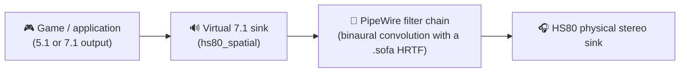

1. **Get a SOFA file.** A good start is the KEMAR dummy head from the [SADIE II database](https://www.york.ac.uk/sadie-project/database.html): `D1_48K_24bit_256tap_FIR_SOFA.sofa`. Take the 48 kHz variant — the filter chain runs at 48 kHz.
2. **Configure and enable:**
   ```bash
   hs80ctl spatial configure /path/to/hrtf.sofa
   hs80ctl spatial default on
   hs80ctl spatial on
   ```
3. **In the game**, set the audio output to **7.1 speakers / surround**.

Perception differs between people. If front and back are hard to tell apart, try another subject from the same database. More in [docs/SPATIAL_AUDIO.md](docs/SPATIAL_AUDIO.md) (German).

---

## Microphone and DSP

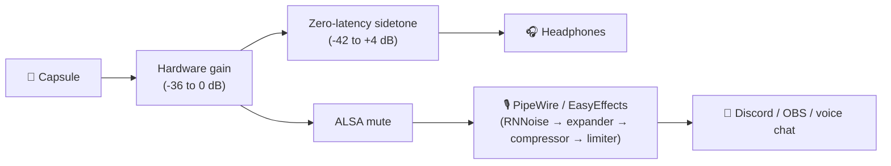

A chain that works well in EasyEffects: high-pass at 80 Hz → RNNoise (moderate) → soft gate around -45 dB → compressor 2.5:1 (attack 10 ms, release 100 ms) → limiter at -1.0 dBFS.

---

## D-Bus interface

- **Bus name**: `io.github.hs80control.Daemon` on the session bus
- **Object path**: `/io/github/hs80control/Daemon`
- **Interface**: `io.github.hs80control.Daemon`

```python
Refresh() -> bool
Reconnect() -> bool
SetRgb(mode: str, brightness: int, logo: str, indicator: str, mic: str) -> bool
UpdateRgb(mode: str, brightness: int, logo: str, indicator: str, mic: str) -> bool
UpdateRgbOptions(speed: int16, mute_indicator: int16, mute_color: str, battery_saver: str) -> bool  # -1 / "" = unchanged
SetSleepTimer(minutes: int) -> bool
SetSidetone(enabled: bool, level_db: float) -> bool
SetMicrophoneGain(level_db: float) -> bool
SetMicrophoneMuted(muted: bool) -> bool
SetBatteryNotify(enabled: bool) -> bool
UpdateVoice(enabled: int16, volume: int16, microphone: int16, charging: int16, battery: int16) -> bool  # -1 = unchanged
PlayVoiceSample() -> bool
ConfigureSpatial(sofa_file: str) -> bool
SetSpatialEnabled(enabled: bool) -> bool
SetSpatialMakeDefault(enabled: bool) -> bool
```

All state is exposed as properties (`BatteryPercent`, `Charging`, `MicrophoneMuted`, `HeadsetConnected`, …) with `PropertiesChanged` signals. Example in Python:

```python
import asyncio
from dbus_next.aio import MessageBus

NAME, PATH = "io.github.hs80control.Daemon", "/io/github/hs80control/Daemon"

async def main():
    bus = await MessageBus().connect()
    proxy = bus.get_proxy_object(NAME, PATH, await bus.introspect(NAME, PATH))
    hs80 = proxy.get_interface(NAME)
    print(f"HS80 battery: {await hs80.get_battery_percent()} %")
    await hs80.call_update_rgb("static", 50, "#00bfff", "#00bfff", "#00bfff")

asyncio.run(main())
```

---

## Architecture

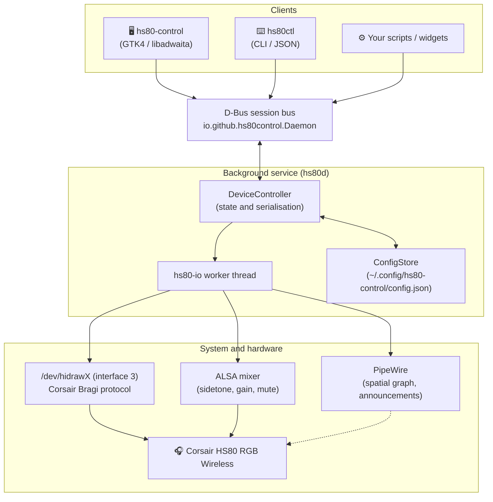

- **No root service**: everything runs in the `systemd --user` session. The udev rule (`uaccess`) grants the logged-in user access to interface 3.
- **One I/O thread**: all HID reads and writes go through a single worker, so RGB updates, heartbeats and commands never race for responses.
- **Audio stays with the kernel**: the audio interfaces and media keys remain with `snd-usb-audio`; nothing is claimed or detached.
- **Atomic settings** in `~/.config/hs80-control/config.json`.

Details: [docs/ARCHITECTURE.md](docs/ARCHITECTURE.md) (German).

---

## Protocol and reverse engineering

The HS80 is controlled through Corsair's **Bragi HID protocol** on USB interface 3 (usage page `0xff42`):

```text
HID write report (64 bytes):
+------+--------+---------+-----------------------+---------------------+
| 0x02 | Target | Command | Payload ...           | 0x00 padding ...    |
+------+--------+---------+-----------------------+---------------------+
  1 B     1 B       2 B      0..60 B                 up to 64 B
```

- **Target `0x08`** addresses the receiver (or the headset itself on its cable), **`0x09`–`0x0F`** the paired wireless headset.
- **Planar RGB**: the three zones are sent in planes (`R_logo R_ind R_mic G_logo G_ind G_mic B_logo B_ind B_mic`), not as RGB triples.
- **Charging state** (property `0x10`): `1` when the cable goes in, `2` when it comes out.

Everything found so far is documented in [docs/PROTOCOL.md](docs/PROTOCOL.md) (German).

---

## Troubleshooting

```bash
hs80ctl doctor
```

| Symptom | Cause | Fix |
| :--- | :--- | :--- |
| `No access to /dev/hidrawX` | udev rule missing | Install `data/udev/70-hs80-control.rules` to `/usr/lib/udev/rules.d/` and replug the receiver. |
| `HS80 receiver not found` | Receiver not plugged in | Check that `lsusb` lists `1b1c:0a6b` (or `1b1c:0a69` on the cable). |
| `receiver reports no connected headset` | Headset off or asleep | Switch it on and run `hs80ctl reconnect`. |
| `headset is charging on its USB cable` | Switched-off headset on the cable (`0a6a`) | Switch it on (it becomes `0a69`) or use the receiver. |
| Conflicts with OpenRGB / ckb-next | Another program uses interface 3 | Quit OpenRGB, ckb-next or OpenLinkHub for the HS80 before starting `hs80d`. |

---

## Development, tests and packaging

```bash
make test               # unit tests
make check              # tests plus spec, AppStream, desktop, udev and systemd checks
make dist               # reproducible source archive
make rpm                # RPM package in build/rpmbuild/RPMS/noarch/
make installer-bundle   # graphical installer in dist/
```

The voice clips are pre-rendered; `tools/render-voice-clips.py` re-renders them through the ElevenLabs API after a phrase changes.

---

## Contributing

Bug reports, hardware reports and pull requests are welcome — see [CONTRIBUTING.md](CONTRIBUTING.md). Changes per version are in the [CHANGELOG](CHANGELOG.md), security reports go through [SECURITY.md](SECURITY.md).

---

## Developed by

<p align="center">
  <a href="https://stickelbroeck.com/">
    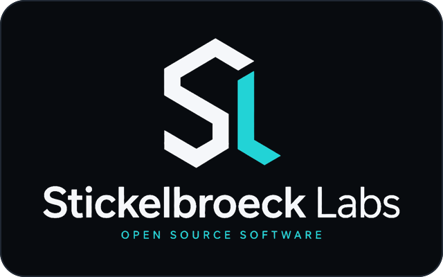
  </a>
</p>

<p align="center">
  HS80 Control is a project by <strong>Stickelbroeck Labs</strong>.<br>
  <a href="https://stickelbroeck.com/">stickelbroeck.com</a>
</p>

---

## License and disclaimer

- **Code**: [GNU General Public License v3.0 or later](LICENSE).
- **AppStream metadata**: [CC0-1.0](LICENSE.CC0).
- **Notices**: see [NOTICE](NOTICE).

> **Disclaimer:** This is an independent open-source project and is not affiliated with or endorsed by Corsair Gaming, Inc. Corsair, HS80 and iCUE are trademarks of their respective owners. Use at your own risk.
